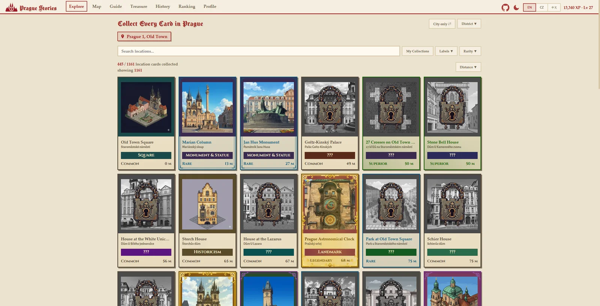
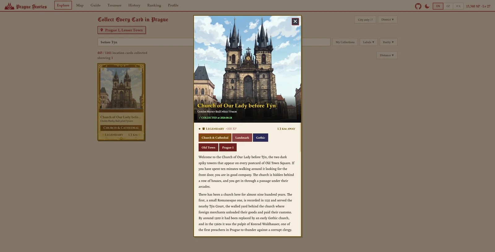
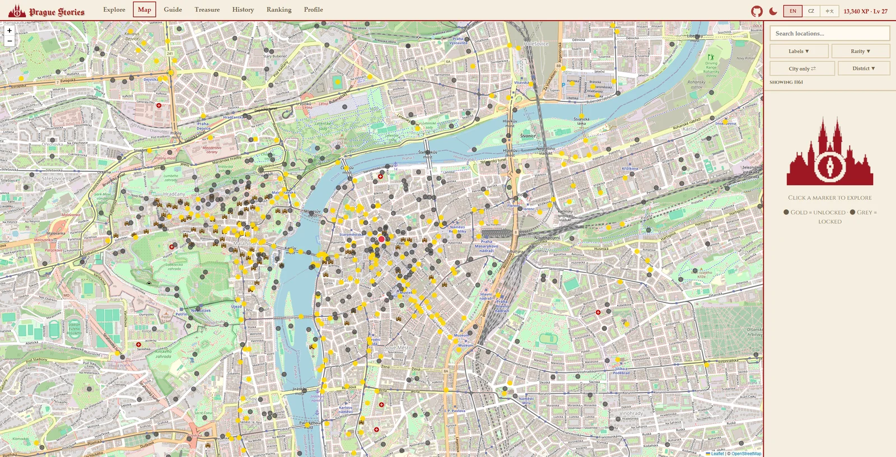
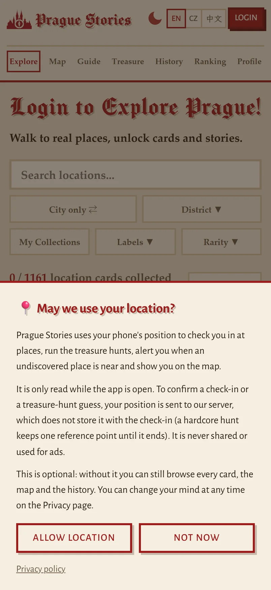
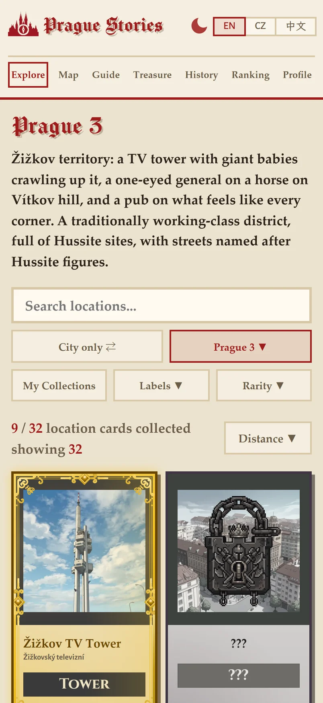
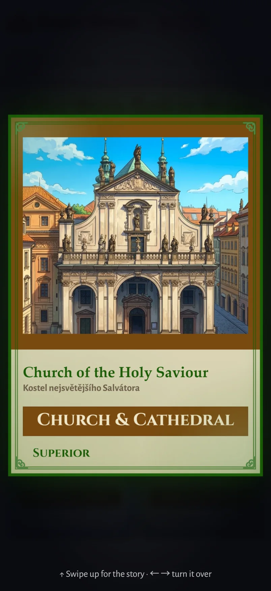
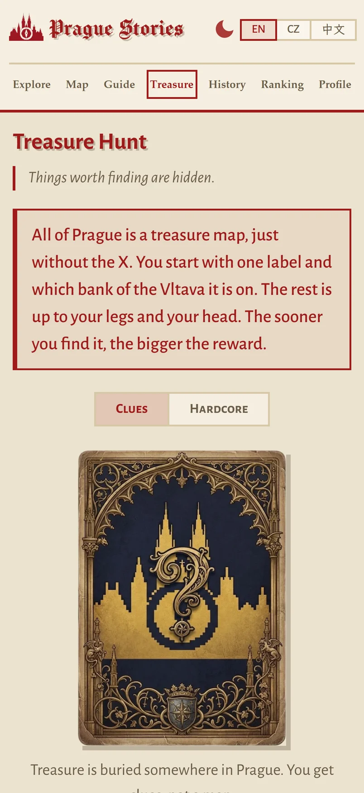
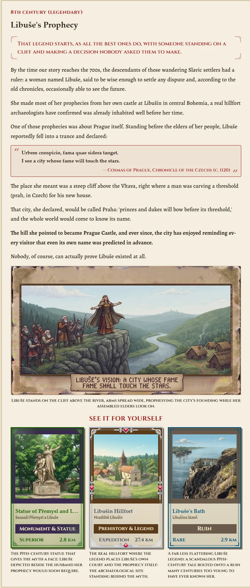

# Prague Stories

A location-based city-exploration game for Prague, built on the MERN stack and installable as a PWA.

Walk to a real place, stand there, and collect its card. More than 1,100 location cards across Prague and Bohemia, each with a hand-written story in English, Czech and Chinese (Simplified/Traditional), plus a History Timeline that tells the story of Bohemia from its legends to the Thirty Years' War. Go there. Stand there. The app notices.

**Live:** https://prague-stories.vercel.app

**User guide:** [GUIDE.md](GUIDE.md)



| Location story | Map |
|---|---|
|  |  |

**On your phone:** a first visit asks before using your location, then browse by district (here Prague 3, with its introduction), long-press a collected card to show it off, and go treasure hunting.

<table>
  <tr>
    <td align="center"></td>
    <td align="center"></td>
    <td align="center"></td>
    <td align="center"></td>
  </tr>
</table>

**History Timeline:** each event has a primary-source quote, an illustration and links to the real places, whose cards open in place.

<p align="center"></p>

---

## Stack

| Layer    | Tech |
| -------- | ---- |
| Frontend | React 18, Vite, React Router 6, Leaflet / react-leaflet, opencc-js |
| Backend  | Node.js, Express (ES modules) |
| Database | MongoDB Atlas, Mongoose |
| Auth     | JWT (jsonwebtoken, bcryptjs) |
| Images   | Local WebP covers with generated thumbnails; Cloudinary as upload backend and fallback |
| AI       | Google Gemini (fallback descriptions for cards without one) |
| Testing  | Jest, React Testing Library, supertest, mongodb-memory-server, Playwright |
| Hosting  | Vercel (client), Render (API), GitHub Actions CI |

---

## Features

### Collect the city

- **1,100+ location cards** in Prague and across Bohemia: castles, Baroque churches, metro stations, Cold War bunkers, a psychiatric hospital that hosts music festivals, the southernmost point of Prague.
- **GPS-verified check-ins:** the server checks you are within 100 m of the place. Check-ins are permanent.
- **Stories are a reward:** until you collect a card, the server sends only the opening of its story; the full text unlocks after the check-in.
- **Proximity alerts:** walk within 50 m of an undiscovered place and the app tells you, with an optional system notification that checks you in when tapped.
- **Card showcase:** long-press (or double-click) a collected card to see it full screen. Drag sideways to flip it over, swipe up to read its story.
- **Explore grid:** filter by grouped labels (era, style, building type, …), rarity, district or historical quarter; sort by distance, newest, rarity or recently collected. Locked cards near you start to reveal themselves.
- **Where you are:** the Explore header shows your Prague district and quarter, worked out on your phone from official boundaries (ČÚZK RÚIAN), so your position never leaves the device.
- **City only / Show all:** cards outside Prague are hidden by default and shown with one toggle.

### Rarity and progression

Seven rarities, shown on every card frame, even on locked cards:

| Rarity     | XP      | |
| ---------- | ------- | --- |
| Common     | 10      | |
| Rare       | 20      | |
| Superior   | 30      | |
| Epic       | 50      | |
| Mythic     | 70      | |
| Legendary  | 100     | Prague's most monumental places |
| Expedition | 60–300  | Cards outside Prague, priced by distance from Charles Bridge; the frame's gem shows the tier |

- **60 explorer levels**, from Newcomer to Prague Legend (40,000 XP), with a level-up celebration (sound, vibration, new title).
- **15 achievements**, from First Step to Subway Maniac (all six metro terminal stations).
- **Leaderboard** and public **explorer pages** with each player's collection.

### Treasure hunts

One hunt a day, two modes. The target's location never reaches the client: the server computes every clue from the position you report.

- **Clue mode:** five guesses, each allowed within a smaller radius (3 km down to 100 m) and paying less (10× down to 1× XP). Clues build up guess by guess: a label and which bank of the Vltava, then rarity and the direction from where you pressed, then district, quarter and a live direction. Distances are given in bands, never exactly, so they can't be triangulated. You can give up a round to take its clues, and re-roll once per hunt.
- **Hardcore mode:** almost no clues, just a rough distance and a "warmer / colder" hint as you walk, a label and the quarter within 1 km, more within 500 m. Three presses for 10× / 5× / 2×. Meant to be a long walk.

### History Timeline

- **370+ hand-written events in 23 eras**, from the legends of Libuše to the Thirty Years' War, all in three languages, with illustrations, primary-source quote boxes, background-knowledge cards and an overview card per era.
- Each event links the real places where it happened; their cards open in place.
- Remembers where you stopped reading, across devices for signed-in users.

### Languages and themes

- Full UI and content in **English, Czech and Chinese**, with a Simplified / Traditional switch (opencc-js; Taiwan terms such as 公尺).
- Light and dark themes. Language and theme follow a signed-in user to every device.

### Privacy

- **No location is read before the user agrees.** A consent dialog on first open explains what is collected and why; both answers look the same, and the app works without location.
- Consent can be withdrawn at any time on the **Privacy** page (`/privacy`), which carries the GDPR notice. Signed-in users' decisions are stored as a versioned record and synced across devices.
- The server keeps no check-in positions and deletes the only stored hunt position when the hunt ends.

### Guest mode and PWA

- A first visit lands straight in guest mode on Explore: everything can be browsed, and collecting needs an account (Login button in the top right).
- Installable on iOS and Android (Add to Home Screen) and runs full screen. A new deploy is picked up automatically the next time the app comes to the foreground.

---

## Getting started

Prerequisites: Node.js 20, a MongoDB instance (local or Atlas), optionally a Gemini API key and a Cloudinary account.

```bash
# 1. Install
cd server && npm install
cd ../client && npm install

# 2. Configure the server (see Environment variables below)
cp server/.env.example server/.env

# 3. Seed the location cards and the History Timeline
cd server
node src/data/seedLocations.js
node src/data/seedHistoryEvents.js

# 4. Start the API (port 5000)
npm run dev

# 5. Start the client (port 5173), in a second terminal
cd client && npm run dev
```

Open http://localhost:5173. With `NODE_ENV=development` the server skips the GPS distance check, so check-ins work without being in Prague.

### Environment variables (`server/.env`)

```env
MONGO_URI=mongodb://localhost:27017/prague-stories
JWT_SECRET=your_jwt_secret_here
JWT_EXPIRES_IN=7d
GEMINI_API_KEY=your_gemini_api_key_here
GOOGLE_TRANSLATE_API_KEY=your_google_translate_api_key_here
CLOUDINARY_CLOUD_NAME=your_cloud_name
CLOUDINARY_API_KEY=your_cloudinary_api_key
CLOUDINARY_API_SECRET=your_cloudinary_api_secret
CLIENT_ORIGIN=https://your-frontend-domain.vercel.app
PORT=5000
NODE_ENV=development
```

---

## Project structure

```
prague-stories/
├── client/                      React + Vite PWA
│   ├── public/
│   │   ├── pixel-art/           cover images (+ thumbs/, generated)
│   │   └── history/             History Timeline illustrations
│   ├── scripts/                 cover manifest, thumbnails, image sizes, Prague boundaries
│   ├── e2e/                     Playwright specs (backend mocked via page.route)
│   └── src/
│       ├── pages/               Explore, Map, TreasureHunt, History, Dashboard, Leaderboard,
│       │                        Explorer, Guide, Privacy, Login, Register
│       ├── components/          locations/, draw/, history/, map/, dashboard/, shared/
│       ├── context/             Auth, Language (i18n + opencc), Theme
│       ├── hooks/               proximity detection, user position, location consent, …
│       ├── services/api.js      axios API layer
│       └── utils/               geolocation, location consent, Prague areas, rarity, covers, …
└── server/                      Express API
    └── src/
        ├── app.js / index.js    app (no listen, used by tests) / entry point
        ├── models/              User, Location, CheckIn, HistoryEvent
        ├── controllers/         auth, location, checkin, user (hunts, leaderboard, …), history
        ├── services/            gamification (levels, achievements, hunt rules), Gemini
        └── data/                seed scripts, rarity map, eras, maintenance scripts
```

---

## API

| Method | Route | Auth | Description |
| ------ | ----- | ---- | ----------- |
| POST | `/api/auth/register` | — | Create an account |
| POST | `/api/auth/login` | — | Returns a JWT |
| GET | `/api/auth/me` | ✓ | Current user |
| GET | `/api/locations` | optional | All cards (no stories), with unlock status when signed in |
| GET | `/api/locations/:slug` | optional | One card; full story only for those who collected it |
| PUT | `/api/locations/:slug` | ✓ | Edit a card |
| POST | `/api/locations/:slug/cover` | ✓ | Upload a cover (WebP via sharp, Cloudinary) |
| GET | `/api/checkins` | ✓ | Check-in history |
| POST | `/api/checkins/:slug` | ✓ | Check in: GPS check, XP, achievements |
| GET | `/api/user/progress` | optional | XP, level, collection breakdown |
| GET | `/api/user/achievements` | optional | Achievements and levels |
| GET / POST | `/api/user/random-draw` | ✓ | Clue-mode treasure hunt: status / start |
| POST | `/api/user/random-draw/guess` · `/skip` · `/reroll` | ✓ | Guess, give up a round, re-roll |
| GET / POST | `/api/user/hardcore-hunt` | ✓ | Hardcore hunt: status / start |
| POST | `/api/user/hardcore-hunt/guess` | ✓ | Press to guess |
| GET | `/api/user/treasures` | ✓ | Cards found in treasure hunts |
| GET / PUT | `/api/user/history-progress` | ✓ | History Timeline reading position |
| PUT | `/api/user/preferences` | ✓ | Theme, language, Chinese script |
| PUT | `/api/user/location-consent` | ✓ | Record location consent or its withdrawal |
| GET | `/api/user/leaderboard` | optional | XP leaderboard |
| GET | `/api/user/explorers/:username` | optional | Public explorer page |
| GET | `/api/history` | optional | Eras and events (`?lang=en\|cz\|zh` trims the payload) |

---

## Scripts

| Where | Command | Purpose |
| ----- | ------- | ------- |
| server | `node src/data/seedLocations.js` | Upsert the seeded location cards |
| server | `node src/data/seedHistoryEvents.js` | Upsert History Timeline events |
| server | `npm run export:locations` | Export the database to the seed files |
| server | `npm run sync:covers` | Download Cloudinary covers to local files |
| server | `npm run sync:expedition` | Recompute rarity/XP of cards outside Prague (`--dry` to preview) |
| server | `npm run purge:hunt-positions` | Delete stored hunt positions that are no longer needed (`--dry` to preview) |
| client | `npm run generate:covers` | Rebuild the cover manifest and thumbnails (also runs on dev/build) |

---

## Testing

```bash
cd server && npm test        # 212 tests: unit + API integration (in-memory MongoDB)
cd client && npm test        # 123 tests: units and React components
cd client && npm run test:e2e   # 57 Playwright tests, backend mocked
```

- **Server:** pure-function tests for rarity and gamification rules, and integration tests that drive the real Express app with supertest against `mongodb-memory-server` (real indexes, populate and write behaviour). Cloudinary and Gemini are mocked.
- **Client:** Jest and React Testing Library for utilities (geolocation, location consent, Prague areas, covers) and components (cards, level-up, preferences and consent sync).
- **End to end:** Playwright with the backend mocked via `page.route`, including mobile touch gestures (card showcase), treasure hunts, check-ins and the consent flow (asserting no geolocation call before consent).
- The server and client Jest suites run in GitHub Actions on every push to `main`.

---

## License

MIT
